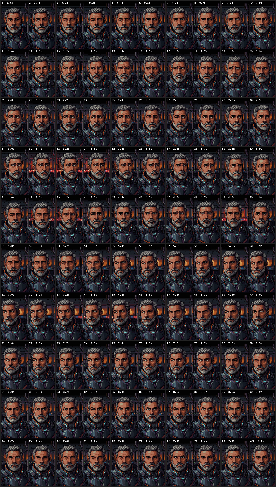

# C64 Portrait Animation

This project turns `c64.mp4`, a 10-second, 720×1280 pixel-art video of a portrait, into a program that plays the same animation on a Commodore 64. It runs at 10 frames per second in C64 hires bitmap mode.

The video was made with a lot of motion on purpose, as a stress test to push the C64 to its limit and see how it would handle it. Head, expression, background and lighting all change. That is why every frame is stored whole and played from a RAM Expansion Unit. For the opposite approach, with motion kept to a minimum on a standard C64, see [`../blink/`](../blink/README.md).


https://github.com/user-attachments/assets/cd8a1182-1782-4c1d-964c-68b4e830043f




## 1. Extracting the frames

The video runs at 24fps. `ffmpeg` sampled it at 10fps, which gave 100 PNG frames:

```sh
ffmpeg -i c64.mp4 -vf fps=10 frames/frame_%03d.png
```

`contact_sheet.png` shows all 100 frames in a 10×10 grid, each labeled with its frame number and time.  The sheet makes it easy to spot the blinks, the changes in expression, and the red light strip flickering in the background.

## 2. Converting to C64 hires (`convert_c64.py`)

### The constraints

The C64's hires bitmap mode is 320×200 pixels, split into 8×8 cells. Each cell can show **only two colors**, picked from the C64's fixed 16-color palette. A full screen takes 8000 bytes of bitmap plus 1000 bytes of screen RAM, which holds the colors for each cell.

### Framing

The source frames are tall (720×1280) and the C64 screen is wide (320×200). We chose to keep the whole image rather than crop to the face. The top 80 rows of the video are a black bar. Removing them leaves 720×1200, which scales by exactly 1/6 to **120×200 pixels**: a strip **15 cells wide and 25 cells tall**, centered on the screen. Nothing of the picture itself is cropped.

### Color conversion

Each frame is converted like this:

1. **Downscale:** the frame is shrunk 6× with area averaging. This also removes the source's scanline effect.
2. **Lighten midtones (`GAMMA = 0.85`):** the source is dark compared with the C64's palette, so the midtones are lifted.
3. **Pick colors per cell:** all 136 possible color pairs (including solid single colors) are tried, using the Pepto PAL palette and comparing colors in CIELAB, which matches how the eye judges color difference. Each pair is scored on two things:
   - how well colors between its two endpoints can represent the cell's pixels;
   - a penalty for dither noise (`DITHER_PENALTY = 1.0`), which favors cleaner, flatter cells.
4. **Dither:** within the chosen pair, each pixel is set by an **8×8 Bayer ordered dither**, a fixed repeating dot pattern. Error-diffusion dithering (Floyd–Steinberg) would usually look a little better on a still image. In an animation, though, it makes unchanged areas shimmer from frame to frame. Ordered dithering keeps any area that didn't change pixel-for-pixel identical.
5. **Reduce flicker:** if the previous frame's color pair for a cell is within 4% of the best pair's score, the old pair is kept. This stops background cells flipping colors between frames.

Several dither and tone settings were compared on the same frame before choosing these values.

### Output format

The script writes three files per frame to `c64/`:

| File | Size | Contents |
|------|------|----------|
| `bitmap_NNN.bin` | 3000 bytes | 375 cells, row by row (15 per row), 8 bytes per cell, highest bit = leftmost pixel |
| `screen_NNN.bin` | 375 bytes | one byte per cell: high nibble = color of the 1-bits, low nibble = color of the 0-bits |
| `preview_NNN.png` | — | the converted frame drawn in the C64 palette, enlarged 3× |

## 3. First test on the C64 (`demo.asm`)

`demo.asm`, built with `build_demo.sh`, is a small test player assembled with ACME. It loads 10 frames straight into C64 RAM and plays them in a loop. Running it in VICE (`x64sc`) confirmed two things: the data layout displays correctly, and the frames animate. See [Running the 10-frame demo](#running-the-10-frame-demo) to try it yourself.

Note that VICE's default palette shows the skin pinker than the previews. That's normal: C64 palettes differ between emulators and monitors, and the data is the same.

## 4. Fitting 100 frames: why the REU

One frame is 3,375 bytes, so 100 frames come to **337,500 bytes**. That causes three problems:

- **RAM:** the C64 has 64 KB, which fits only about 10 frames alongside the program.
- **Disk space:** a 1541 disk (`.d64`) holds about 170 KB, half of what's needed.
- **Disk speed:** playing straight from disk at 10fps needs about 34 KB/s. A 1541 reads about 0.4 KB/s through the KERNAL (the C64's built-in system routines) and roughly 5–10 KB/s with a fast loader. Its physical limit is about 25 KB/s, so true 10fps streaming from a stock drive is impossible.
- **Delta compression doesn't help much:** about 260 of the 375 cells change between frames on average, because the source has a lot of small movement.

The solution is a **RAM Expansion Unit (REU)**:

- **Disk:** everything goes on one 1581 disk (`.d81`, 800 KB).
- **Loading:** at startup, every frame is loaded from disk into the REU.
- **Playback:** frames are copied out of the REU by DMA, a hardware copy that moves one byte per CPU cycle. The CPU only sets up each transfer.

## 5. The player (`player.asm`)

The player works in three stages:

1. **REU check.** It writes to the REU's registers and reads them back to confirm a REU is present. It then writes different marker bytes to bank 0 and bank 4: a REU smaller than 512 KB wraps bank 4 onto bank 0, which reveals that it's too small. Without a suitable REU it prints `THIS NEEDS A REU OF 512 KB OR MORE.`
2. **Load.** Files `F001`–`F100` are loaded with the KERNAL `LOAD` routine from the drive the player started from, into a buffer at `$4000`. Each one is copied into its own 4 KB slot in the REU, so frame *n* is at REU address *n*×$1000. One dot is printed per frame. If a load fails, the player stops with `LOAD ERROR: F0nn`.
3. **Play.** The player switches to hires bitmap mode, with the bitmap at `$2000` and screen RAM at `$0400`, and the strip at column 12. It works out PAL or NTSC from the number of raster lines (the lines the TV beam draws per screen), so it waits 5 or 6 screen refreshes per frame, giving 10fps on both. Each update starts at raster line 251, just below the picture, and fetches the frame from the REU with 50 small DMA transfers: one bitmap row (120 bytes) and one color row (15 bytes) for each of the 25 cell rows.

Two details make the playback smooth:

- **Interleaved rows.** The frame files on disk are stored row by row: 120 bitmap bytes, then that row's 15 color bytes. The REU's address advances on its own after each transfer, so each frame is one continuous read. The rows are written top to bottom, which stays well ahead of the TV beam, so the picture never tears and pixels and colors never mismatch.
- **Cheap updates.** A whole frame update takes about 5,000 CPU cycles, out of about 19,700 per PAL screen refresh.

`build_player.sh` rewrites the frame data into this row-by-row layout, assembles the player with ACME, and writes `c64anim.d81` with VICE's `c1541` tool.

### Testing in VICE

The player was tested in `x64sc` in each of these situations:

| Situation | Result |
|-----------|--------|
| PAL, 512 KB REU | plays; screenshots 0.3 seconds apart differ, so frames are advancing |
| NTSC, 512 KB REU | plays at the correct speed |
| No REU | prints the REU-required message |
| Disk with `F050` deleted | loads 49 frames, then prints `LOAD ERROR: F050` |
| No working drive | prints `LOAD ERROR: F001` |
| Real 1581 drive emulation | loads correctly, but slowly (see below) |

The missing-frame test caught a bug: the filename printed in the error message wasn't terminated. Printing ran on into the title text, which begins with a clear-screen code. That's fixed.

**Loading speed** depends on the drive:

| Setup | Per frame | All 100 frames |
|-------|-----------|----------------|
| VICE via `run_me.sh` (fast virtual drive) | ~0.35 s | **about 40 seconds** |
| VICE emulating a 1581 exactly (`-drive8truedrive`) | ~8–10 s | over 10 minutes |
| Real 1581 drive (standard KERNAL loading) | ~8–10 s | over 10 minutes |

VICE's fast virtual drive intercepts the KERNAL's load routine and reads the disk image directly, skipping the slow serial-bus transfer that a real drive has to do. The 10+ minutes therefore applies only to real hardware, or to VICE with exact drive emulation turned on. A fast loader would bring the real-hardware time down a lot.

## Files

| File | Purpose |
|------|---------|
| `c64.mp4` | source video |
| `frames/` | 100 extracted PNG frames (git-ignored, recreated when needed) |
| `contact_sheet.png` | all frames in one image |
| `convert_c64.py` | PNG → C64 hires converter |
| `c64/` | converted bitmap/screen data (committed) and previews (git-ignored) |
| `demo.asm`, `build_demo.sh` | 10-frame in-RAM test player (no REU needed); `build_demo.sh` writes `demo_frames.asm` and `demo.prg` |
| `player.asm`, `build_player.sh` | REU player and disk builder |
| `build/` | intermediate files (row-by-row frame files, assembled player) |
| `c64anim.d81` | bootable disk: player plus 100 frame files |
| `c64anim.d81.sha`, `c64/source.sha` | content hashes `run_me.sh` uses to tell whether anything changed (committed) |
| `run_me.sh` | rebuilds only what's out of date and starts VICE |

## How to run it

### Requirements

- **[VICE](https://vice-emu.sourceforge.io/)**: provides `x64sc` and `c1541`.
- **[ACME](https://sourceforge.net/projects/acme-crossass/)**: the 6502 assembler (`brew install acme`).
- **Python 3** with **Pillow** and **NumPy**.
- **ffmpeg**: only needed when the video or converter changes, to extract the frames.

Python and ffmpeg are only needed when the video or converter changes, and ACME only when the player changes.

### In VICE

```sh
./run_me.sh
```

The script rebuilds only what's out of date. A fresh clone is already up to date, so it goes straight to VICE.

It decides what's out of date by comparing **content hashes**, not file dates. Git gives every file a new date on checkout, so dates can't be trusted after a clone. In detail:

| What changed | What `run_me.sh` does |
|--------------|-----------------------|
| nothing | nothing; starts VICE straight away |
| `player.asm` or `build_player.sh` | rebuilds the disk image (a few seconds) |
| `convert_c64.py` (settings) | extracts frames if needed, reconverts, rebuilds the disk |
| `c64.mp4` | re-extracts frames (removing the old ones), reconverts, rebuilds the disk |

The player uses frames 1–100, so a replacement video must be at least 10 seconds long. Anything after 10 seconds is ignored, and a shorter video stops the disk build with a missing-frame error.

It then starts `x64sc` with a 512 KB REU and the fast virtual drive. The frames load in about 40 seconds, one dot per frame, then the animation plays. Any extra arguments go straight to VICE. For example, `./run_me.sh -ntsc` runs it as an NTSC machine.

To start it by hand instead:

```sh
x64sc -reu -reusize 512 +drive8truedrive -trapdevice8 -autostart c64anim.d81
```

### Running the 10-frame demo

The demo plays a short stretch of the animation entirely from C64 RAM, so it needs **no REU and no disk loading**. It's useful for quickly checking a few frames, or for showing the animation on a standard C64.

The demo uses the converted frames in `c64/`, which are committed, so it builds straight after a clone. If you change the converter or video, run `./run_me.sh` first so `c64/` is up to date.

```sh
./build_demo.sh                  # frames 11–20 (includes a blink)
x64sc -autostart demo.prg
```

To pick a different stretch, give the first frame and the number of frames:

```sh
./build_demo.sh 41 10            # frames 41–50
./build_demo.sh 1 5              # frames 1–5
x64sc -autostart demo.prg
```

Details and limits:

- **At most 10 frames.** Each frame is 3,375 bytes, stored from `$4000`. An 11th frame would run into the C64's I/O area at `$D000`, so the assembler stops with "too many frames" instead of building a broken program. Frame numbers must stay within 1–100.
- **The picture:** the same 15-column strip as the main player, centered on the screen.
- **Speed is tuned for PAL:** about 10fps. Unlike the main player it doesn't detect NTSC, so on an NTSC machine it runs a little faster.
- **Simpler drawing:** the CPU copies each frame without waiting for the screen to finish drawing, so an occasional frame can briefly show half old and half new. The main player avoids this.
- **On real hardware:** `demo.prg` is about 48 KB. Put it on a disk image with `c1541 -format "demo,01" d64 demo.d64 -write demo.prg demo`, then `LOAD"DEMO",8,1` and `RUN`. Loading takes about 2 minutes from a 1541.

### On real hardware

You need a REU of **512 KB or more**: a Commodore 1750, an Ultimate 1541 II / Ultimate 64 with the REU enabled, or a Turbo Chameleon. Write `c64anim.d81` to a 1581 disk or mount it on an SD2IEC or Ultimate, then:

```
LOAD"*",8
RUN
```

Expect a load of over 10 minutes from a real 1581 before playback starts (see the loading-speed table above).

### Changing the look

Edit `DITHER_PENALTY` or `GAMMA` at the top of `convert_c64.py`, then run `./run_me.sh` again. It reconverts the frames and rebuilds the disk once; later runs start straight away until something changes again.
